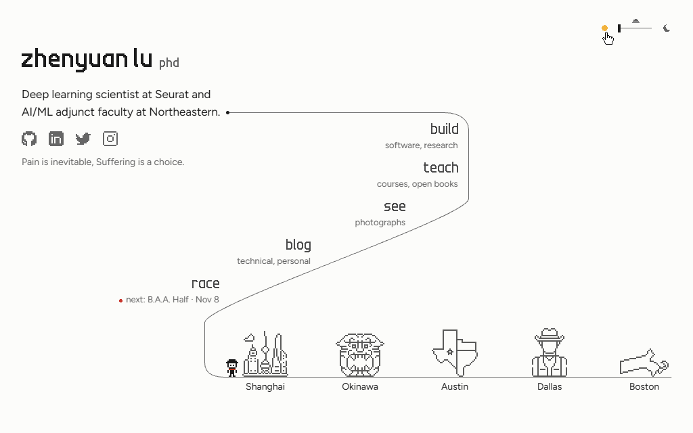
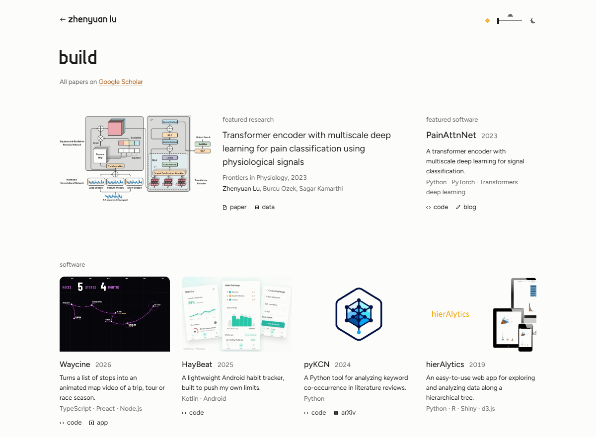
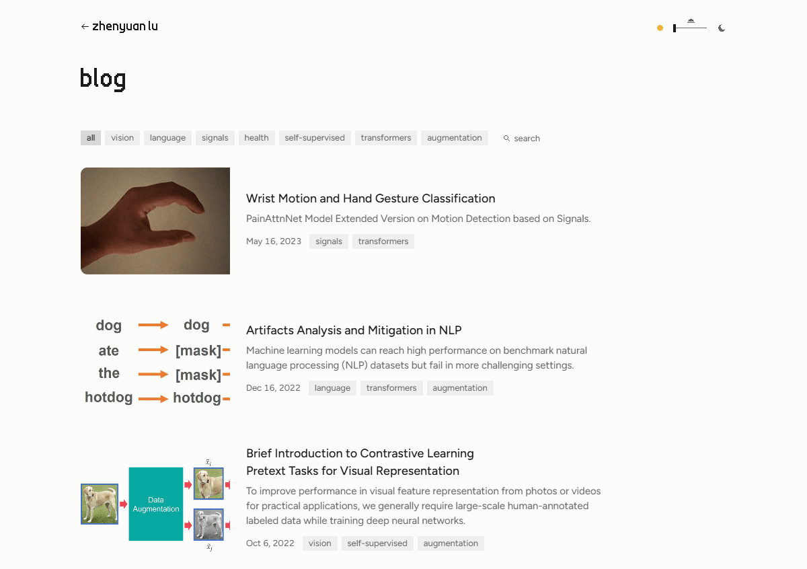
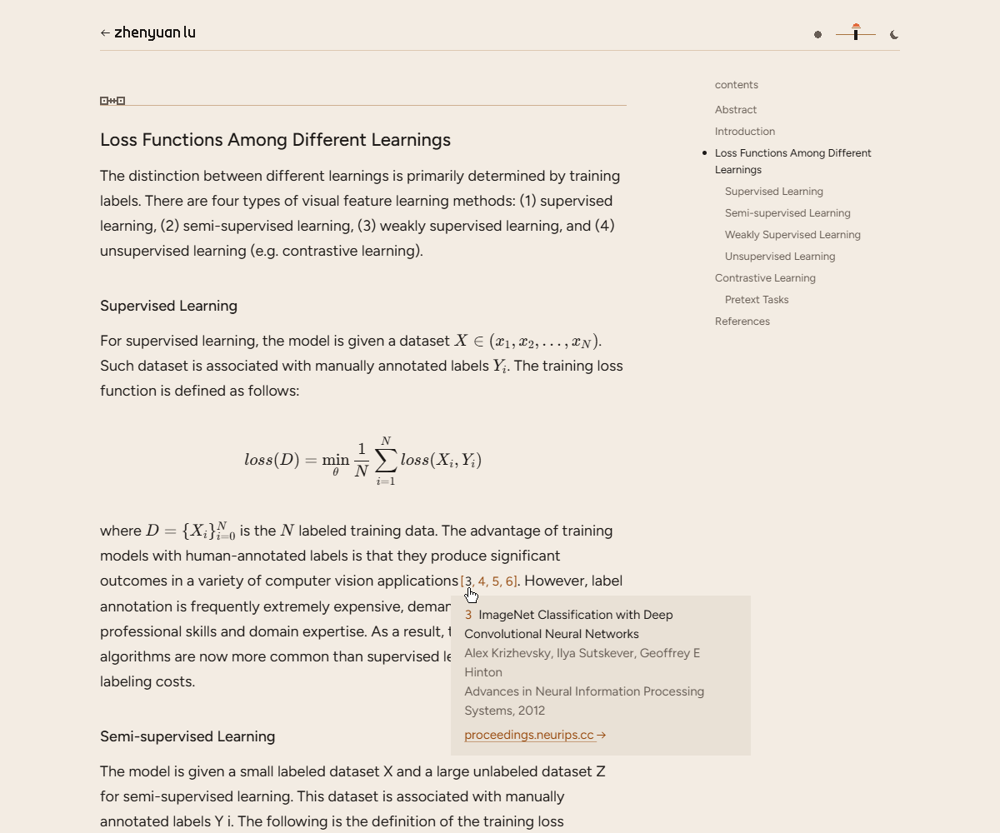
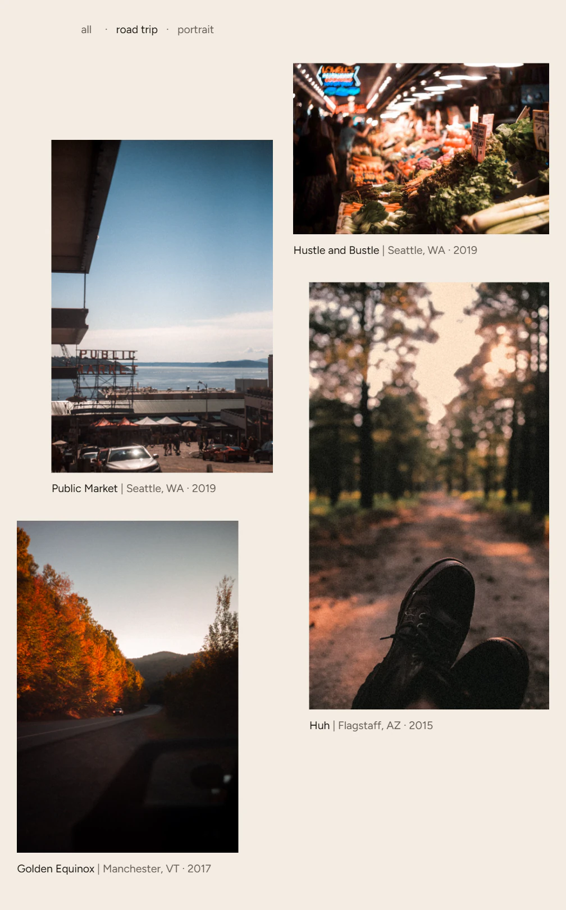
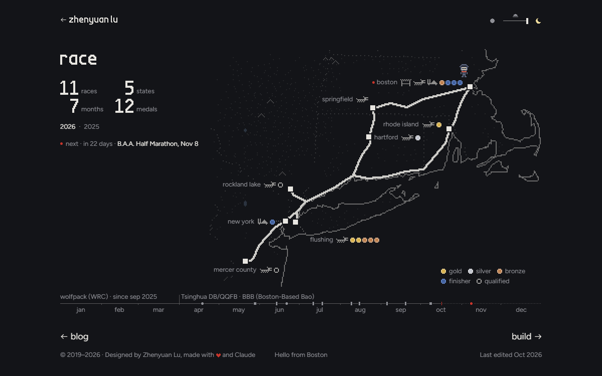
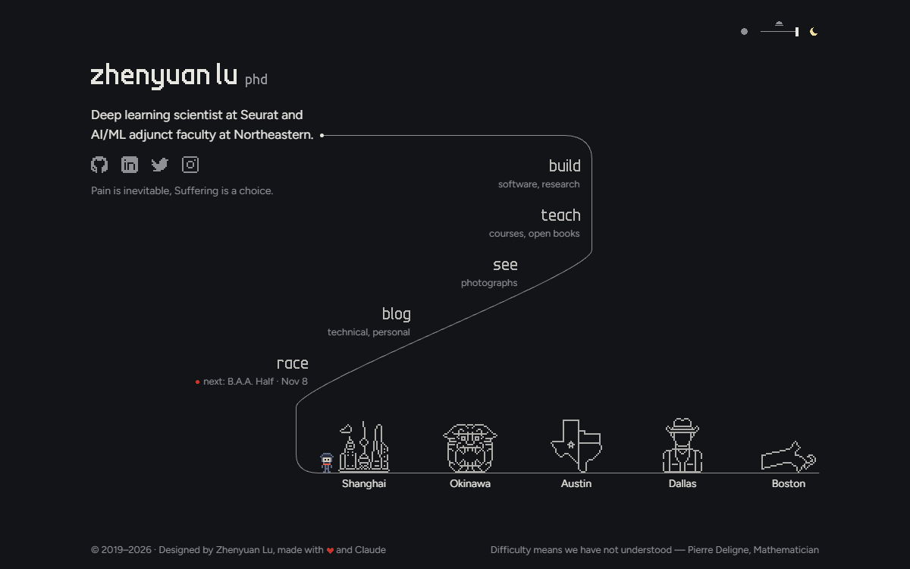
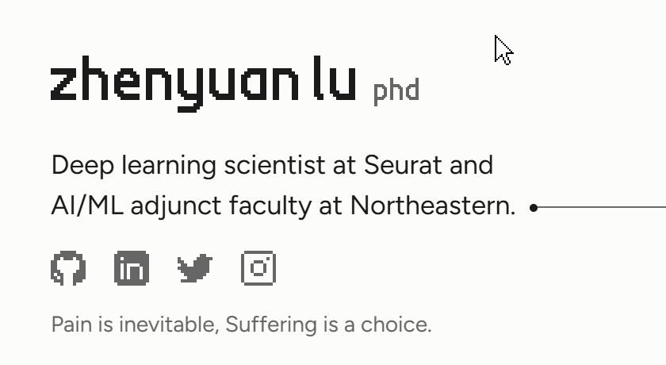
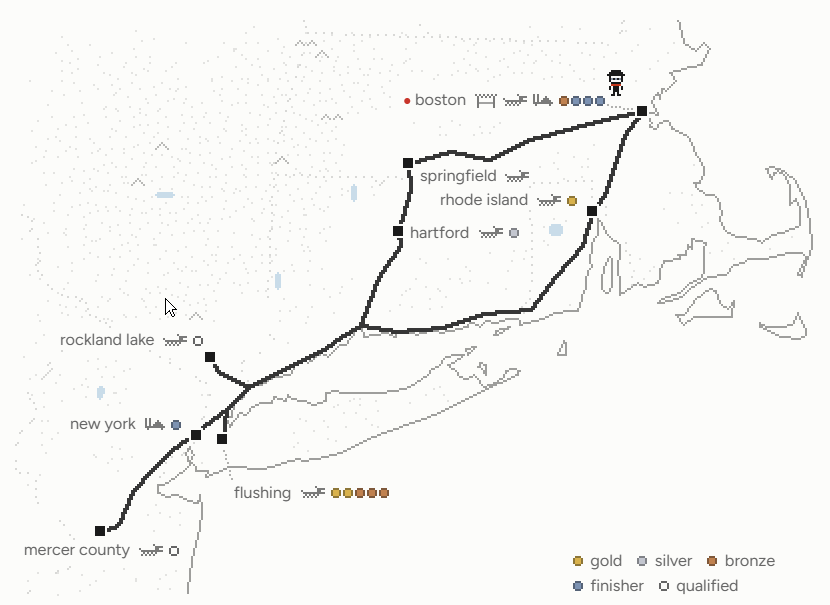

# zhenyuanlu.com

The personal site of Zhenyuan Lu, at [zhenyuanlu.com](https://zhenyuanlu.com): five doors on one road (build, teach,
see, blog and race), the words drawn in pixel letters, and a fader that takes every page from day to dusk to night.

[](https://github.com/zhenyuanlu/zhenyuanlu.github.io/actions/workflows/deploy.yml)
[](package.json)
[](.nvmrc)
[](LICENSE)



<p>
  
  
  <br>
  
  
  <br>
  
  
</p>

By day, build and the blog; at dusk, an article and see; at night, race and the home.

Half a second's rest on the name splits it into its syllables, the pinyin over each and the hanzi under.



On race, a race pinned sends the little figure along the season's highways to it, and its scene and card come in.



## Run it

With Node 24, as in `.nvmrc`:

```sh
npm ci          # the first time
npm run dev     # localhost:4321
npm run check   # before a commit
```

`npm run dev` shows the drafts too and reloads as you save; `npm run check` runs astro check, a clean build, then the
checks of its links, HTML, CSP and speed budget.

## Write a post

```sh
npm run new:post "The post's title"
```

It writes `content/blog/<slug>/index.md` from `scripts/templates/post.md`, as a draft. The slug is the title in lower
case, its words joined by hyphens: it is the post's address, `/blog/<slug>/`, and it stays once the post is out. Put
the post's pictures beside it, run `npm run dev`, and set `draft: false` when it is ready.

## More

Everything else (where the content lives, pictures, citations, the old addresses, the speed budget, the deploy) is in
[DEVELOPMENT.md](DEVELOPMENT.md). The design, from the light to the pixel art, is in [DESIGN.md](DESIGN.md).

## License

[MIT](LICENSE).
