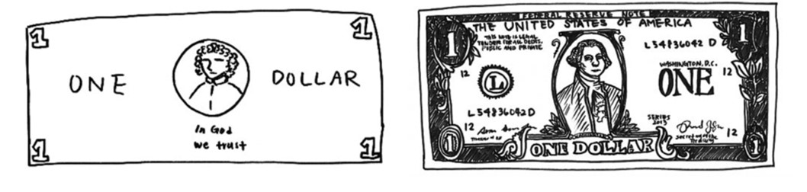
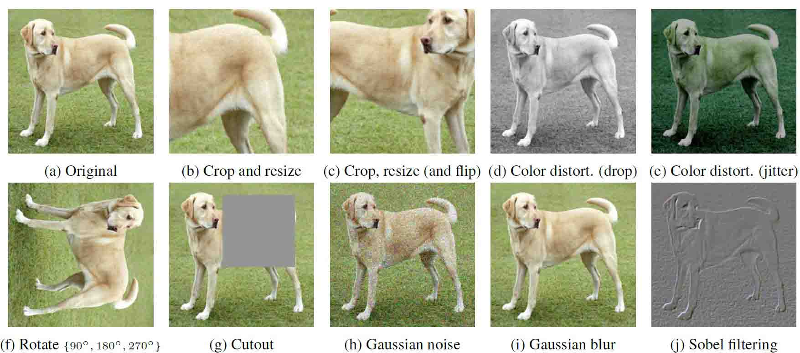
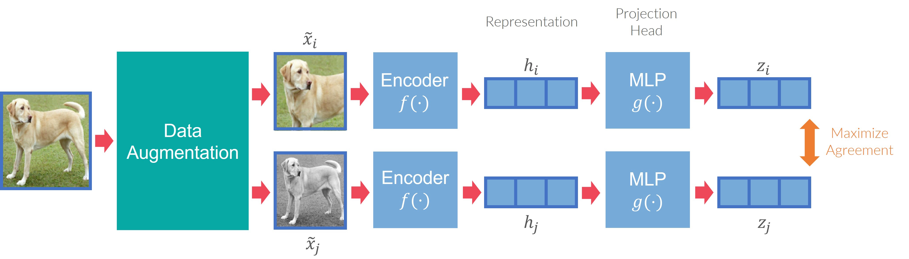

This page is the blog's format, shown on itself. Each section sets one part of a post and prints, under it, the Markdown that makes it. Nothing here is a real post: the authors above are placeholders and the pictures are borrowed from the contrastive-learning post.

## The head

A post opens with the way back to the blog, then its title and one sentence that says what it is about. A title longer than 60 letters is set a size smaller. Between two hairlines the byline gives, each under a small label, the people who wrote it and, when any of them has one, their affiliations, a line each beside their names; the day it was published and, if it was changed later, the day it was updated under it; the post's DOI when it has one, else the reading time (counted from the words at 220 a minute); and the topics, the blog's own tags. The share button at the end of that line opens a small menu: it copies the link, or hands it to X, LinkedIn, Facebook, an email or the device's own share sheet.

Under the byline stand the post's own links, each a small sign and a word: the paper, its PDF, the code, the slides. They are written in ink and take the accent in hand, as the links on the build page do.

All of it comes from the lines at the top of the file (README.md lists every one of them).

```yaml
---
title: A format guide for the blog
description: Every part of a post on this blog, shown once, with the Markdown that makes it.
date: 2026-10-13
updated: 2026-10-13
authors:
  - name: First Author
    affiliation: An affiliation
  - name: Second Author
    affiliation: Another affiliation
topics: [vision, self-supervised]
cover: ./cover.webp
coverAlt: What the cover shows, for a reader who cannot see it.
bibliography: ./refs.bib
links:              # kind: paper, arxiv, pdf, code, slides, patent, data, video, web
  - { kind: arxiv, href: "https://arxiv.org/abs/2002.05709" }
  - { kind: code, href: "https://github.com/google-research/simclr" }
doi: 10.48550/arXiv.2002.05709    # the post's DOI: in the byline, in "Cite this post" and for Google Scholar
updates:            # what changed after it was published, in the foot
  - { date: 2026-10-16, note: "A sentence on what changed." }
motif:              # the post's own small picture on each chapter's rule: rows of # and .
  - ".....##"
  - "....#.#"
hidden: true        # off the list and the feeds; the address still works
draft: true         # built in dev and in the LAN preview only
---
```

## Contents

The contents are made from the headings: `##` is an entry and `###` an entry one step in. On a desk they stand in the rail at the right and stay in view; the section being read is marked, and the rail steps aside while a picture wider than the text passes under it. On a phone they fold into one line under the head. Nothing is written for them.

## Headings and text

A section's heading stands under a hairline across the text. It carries its own address. Point at one and a small mark shows after it; the mark is a link to that section, to copy or to send.

### A smaller heading

Text is set at 18 on 30, about 75 letters to a line. A link looks like [this one to the blog](/blog/), **strong words** are a little heavier, and `inline code` is set in the mono face. A list is a run of short lines:

- one thing,
- another thing,
- and a last one.

> A quotation stands a step in, in grey.
> It may run over several lines.

````md
## Headings and text

### A smaller heading

A link looks like [this one to the blog](/blog/), **strong words** are a
little heavier, and `inline code` is set in the mono face.

- one thing,
- another thing,
- and a last one.

> A quotation stands a step in, in grey.
````

## Figures and their widths

A figure is a picture with a caption. Captions are numbered in order, and the text points to a figure by its label: this sentence points to @fig:dollar. A picture is never drawn larger than its own pixels, so a small file stays small whatever width is asked for, in the middle of its width.

\{#fig:dollar\}

There are three widths, and a fourth for the rare picture that wants the whole window. The measure is the default. `{.wide}` is a column wider: the width an inner page gives its text.

\{#fig:views .wide\}

`{.full}` is the whole frame, from the text's left edge to the rail's right edge; the contents step aside while it passes.

\{#fig:framework .full\}

`{.screen}` is the window, edge to edge. @fig:screen is a live figure at that width.

<LiveFigure name="sine" id="fig:screen" width="screen" caption="Screen: the window's whole width. The caption keeps to the text's column." />

```md
This sentence points to @fig:dollar.

{#fig:dollar}

{#fig:views .wide}

{#fig:framework .full}

<LiveFigure name="sine" id="fig:screen" width="screen" caption="Screen: the window's whole width." />
```

Two more, for older pictures: `{-}` keeps a figure out of the numbering, and `{max=60%}` holds a small picture to a share of its width. A video (`.mp4`) is a figure with controls that plays only when asked, an animated `.gif` waits for play on its first frame, and a picture on another site (a YouTube address too) is not loaded: its caption stays, with a way to it, so nothing of another site loads here. In an `.mdx` file the braces of an attribute are written `\{#fig:x\}`, because MDX reads a bare brace as code.

## Mathematics

A formula in a sentence, such as $L = \frac{1}{N} \sum_{i=1}^N l_i$ or $\hat{x}_i \in X$, sits on the line and does not push the lines apart. A formula on its own is centred on the measure with room above and below:

$$l_{i,j} = -\log \frac{\exp(\mathrm{sim}(z_i, z_j)/\tau)}{\sum_{k=1}^{2N} 1_{[k \neq i]} \exp(\mathrm{sim}(z_i, z_k)/\tau)}$$ \{#eq:nce\}

A label gives it a number at the right, and the text can point to it: equation @eq:nce is the loss of one positive pair. A formula without a label has no number. One that is too long for the measure keeps its size and scrolls sideways in its own box; on a phone it is set smaller, and broken, until it fits. A dollar sign that is only a dollar sign is written with a backslash: the cluster cost \$4 an hour, not \$40.

$$L(D_1, D_2) = \min_{\theta} \frac{1}{N} \sum_{i=1}^N l(X_i, Y_i) + \frac{1}{M} \sum_{i=1}^{M} l(Z_i, R(Z_i, X)) + \frac{\lambda}{2} \sum_{j=1}^{K} \theta_j^2 + \frac{\mu}{M} \sum_{i=1}^{M} \|Z_i - \bar{Z}\| + \frac{\nu}{K} \sum_{k=1}^{K} \|W_k - W_0\|^2$$

```md
A formula in a sentence, such as $L = \frac{1}{N} \sum_{i=1}^N l_i$, sits on the line.

$$l_{i,j} = -\log \frac{\exp(\mathrm{sim}(z_i, z_j)/\tau)}{\sum_{k=1}^{2N} 1_{[k \neq i]} \exp(\mathrm{sim}(z_i, z_k)/\tau)}$$ {#eq:nce}

Equation @eq:nce is the loss of one positive pair.

The cluster cost \$4 an hour, not \$40.
```

## Citations

A citation is a small numbered mark [@chen2020]. Several sources share one pair of brackets [@oord2018; @krizhevsky2012], and a source cited twice keeps its number [@chen2020]. Point at a mark, or reach it with the Tab key, and a card says what it is; a click goes to the list at the end, where each entry leads back to the places that cite it.

The sources live in a BibTeX file beside the post. The key after the `@` is the entry's key. A citation may carry a few words before its source and the place in it after a comma, as Pandoc writes them [see @chen2020, sec. 3; @oord2018, p. 4]. Brackets that hold an `@` but read as neither, two sources without a `;` between them for one, stop the build and say on which line.

```md
A citation is a small numbered mark [@chen2020]. Several sources share
one pair of brackets [@oord2018; @krizhevsky2012], and words and a place
go with them [see @chen2020, sec. 3; @oord2018, p. 4].
```

## Footnotes

A footnote is a thought that would interrupt the sentence.[^thought] Point at its number, or reach it with the Tab key, and the note shows in a card, as a citation's does; on a phone a tap shows it. A click on the number goes to the notes, listed again at the end.[^end]

[^thought]: This is the note. It is set small, and it may hold a [link](/blog/), `code` or a formula such as $x^2$.
[^end]: Each note in that list has a way back to its place in the text.

```md
A footnote is a thought that would interrupt the sentence.[^thought]

[^thought]: This is the note. It is set small.
```

## Guides

Three quiet things lead the reader. An aside is a note without a number: a quiet block a step in, on every screen.

:::aside
An aside says something next to the text: a definition, a date, a pointer to another post.
:::

A call-out is a block with a thin rule at its left and a small label. There are three, and none of them shouts.

:::note
A note adds something the text assumes: a convention, a unit, where the data came from.
:::

:::tip
A tip is a shorter way, or a thing worth trying.
:::

:::caution
A caution is where care is needed. It is not red: red on this site means something is happening now.
:::

```md
:::aside
An aside says something next to the text.
:::

:::note
A note adds something the text assumes.
:::

:::tip
A tip is a shorter way, or a thing worth trying.
:::

:::caution
A caution is where care is needed.
:::
```

## Tables

A table is set small, with a hairline under its head. It takes the same widths as a figure, and a line under it is its caption.

| Width | Written | Reaches |
| --- | --- | --- |
| measure | nothing | the text's column |
| wide | `{.wide}` | the text and a column more |
| full | `{.full}` | the whole frame |
| screen | `{.screen}` | the window |

Table: The four widths. \{#tbl:widths\}

```md
| Width | Written | Reaches |
| --- | --- | --- |
| measure | nothing | the text's column |
| wide | `{.wide}` | the text and a column more |

Table: The four widths. {#tbl:widths}
```

## Code

Code is set in the mono face. The block says its language and offers to copy itself; the lines named in braces are marked. Comments and strings are a tone quieter than the code, and that is all the colour there is.

```python {4-5}
import math

def wave(f, t):
    # one sample of a sine wave: f in hertz, t in seconds
    return math.sin(2 * math.pi * f * t)

print("at a quarter of a second:", wave(2, 0.25))
```

````md
```python {4-5}
import math

def wave(f, t):
    # one sample of a sine wave: f in hertz, t in seconds
    return math.sin(2 * math.pi * f * t)
```
````

## A live figure

A live figure holds a drawing that can move, with its own controls and caption. It stands still until it is asked: press play, or move the slider. It stops when it leaves the window, and under reduced motion it never runs; the slider still redraws it.

<LiveFigure name="sine" id="fig:sine" caption="One second of a sine wave. The slider sets its frequency; play slides the second along at a tenth of real speed." />

The figure is a component in the post's folder: a small script that is given a canvas and draws one frame at a time. The page around it owns the play word, the sliders, the still at rest and the rule that nothing moves by itself.

```mdx
<LiveFigure name="sine" caption="One second of a sine wave." />
```

```js
// sine.live.js: a live figure says its controls and draws one frame
export default {
  ratio: 3.2,
  controls: [{ id: "f", label: "frequency", min: 1, max: 6, step: 0.5, value: 2, unit: "Hz" }],
  draw({ ctx, w, h, t, v, ink }) {
    // t: seconds since play; v.f: the slider's value
  }
};
```

## The foot

Each chapter after the first opens with the post's own small pixel picture standing on its rule, drawn from its subject: the `motif` rows at the top of the file. A post without them has three dots, a talk a speech bubble.

A post ends with a band of its own after the text, under a hairline across the page. First come the sections the author writes for it, such as the acknowledgements: each is a block `:::appendix` with its title, written anywhere in the text and set in the foot. Then the footnotes, each with the way back to its place; the references, each with the way back to where it is cited; the updates, when the post has any; and a block that says how to cite the post itself, with a copy word. On a desk each part's title stands at the left, beside it.

:::appendix Acknowledgements
This guide's pictures are borrowed from the contrastive-learning post.
:::

```md
:::appendix Acknowledgements
The data were provided by a partner, whom we thank.
:::
``` After that come the older and the newer post, and the doors.
