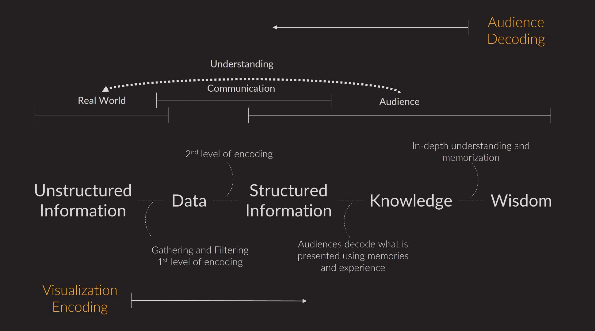

{max=80%}

The purpose is to help students understand what kinds of data visualization challenges exist in the real world. We will discuss several techniques to dealing with common issues/problems encountered in the actual world or industry.

{-}
