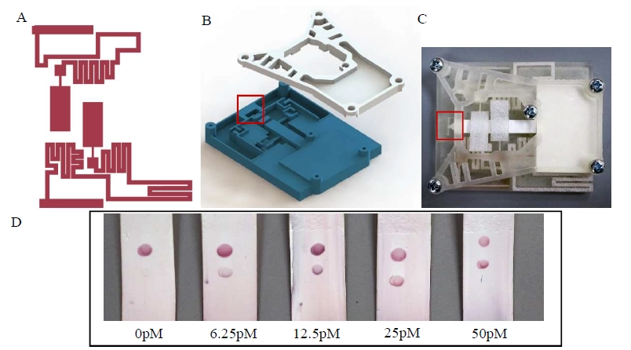

## Our Lab

{.full max=80%}

## Abstract

Gastroenteritis is one of the most common and deadly diseases, causing a combination of diarrhea, vomiting, and abdominal pain. In developing countries, there is a lack of advanced medical instruments, well-trained medical personnel and funding to process complex diagnostic tests that inform treatment decisions. Therefore, there is a need to develop inexpensive, easy-to-use, rapid, portable and highly sensitive detection assays that do not require a complex testing procedure or highly trained personnel. To address this need, we have developed of a novel lateral flow immunoassay (LFIA) that uses colorimetric signal enhancement of gold nanoparticles (AuNP) that can be integrated with a point-of-care, swab-based sample preparation cartridge. These LFIA devices were fabricated using a combination of laser cutting and wax printing to create physical or hydrophobic barriers that directly metered volumes of sample fluids extracted from the Cartridge onto the LFIA test strip. Capillary action was used to draw fluids toward the reaction zone where embedded multiplex immunoassay reagents were embedded in a 3 x 3 microarray spot pattern. In the presence of the target pathogen, a sandwich based immunoassay complex formed between the capture antibody, pathogen, and detecting antibody, yielding a spatially resolved colorimetric signal. Assay results using a single pathogen, Norovirus GII.4 virus-like particles (VLPs), yielded visible AuNP signals in the presence of as little as 50 pM VLP protein using this 2-stage integrated sample prep/detection system.

{max=80% -}

{max=70%}
